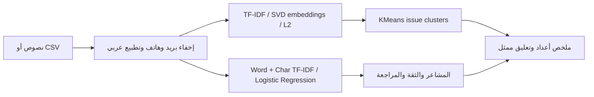

# Voice of Customer Analyzer

**المتدربة:** Wadeen Khalid Al adwani

**المدرب:** مضر محمد الفضلي
**أكاديمية سدايا — المشروع رقم ٣ — تسليم فردي بموافقة المدرب وفق تأكيد المتدربة**

تحليل تعليقات العملاء بالعربية: **تصنيف المشاعر، تجميع المشكلات باستخدام embeddings، وتلخيص الرؤى مع تعليق ممثل لكل مجموعة**. يأخذ النظام نصوصًا أو CSV ويعرض المشاعر والموضوع والثقة وطلب المراجعة البشرية. الهدف تسهيل قراءة التعليقات المتكررة، والمقياس الرئيس Macro-F1 على مجموعة اختبار ثابتة.

**تنبيه عن النتائج:** البيانات تعليمية مؤلفة وليست تعليقات عملاء حقيقية. النظام ليس جاهزًا لقرارات تشغيلية مستقلة. تفاصيل استخدام المساعدة البرمجية موضحة في [STUDENT_PROFILE.md](STUDENT_PROFILE.md).

## تشغيل المشروع

```bash
bash scripts/run_all.sh
UV_CACHE_DIR=/workspace/.cache/uv uv run --frozen python app.py
```

Python 3.12 وuv. لا يحتاج مفتاح API أو GPU. الخطوات الكاملة وColab في [GETTING_STARTED.md](GETTING_STARTED.md). الدفتر الرئيس: [Voice_of_Customer_NLP_Wadeen_Khalid_Al_adwani.ipynb](Voice_of_Customer_NLP_Wadeen_Khalid_Al_adwani.ipynb).

## البيانات

| Split | Size | Language/style | Source |
| --- | ---: | --- | --- |
| Train | 102 | فصحى 45، خليجي 45، إنجليزي 12 | أمثلة أصلية تعليمية مؤلفة |
| Validation | 30 | فصحى 15، خليجي 15 | نفس المصدر، نصوص مختلفة |
| Test | 66 | فصحى 30، خليجي 30، إنجليزي 6 | اختبار ثابت يتضمن ظواهر صعبة |

الفئات: إيجابي / سلبي / محايد. لا تدخل التسميات أو شرائح اللغة إلى ميزات التنبؤ. فحص التكرار بعد التطبيع، والتدريب على train فقط، واختيار C على validation فقط؛ لا ندعي غياب التشابه الدلالي بين أمثلة المؤلف نفسه. راجعي [DATA_CARD.md](DATA_CARD.md).

## المنهج



Baseline: unigram TF-IDF + Naive Bayes. Improvement: word bigrams + character n-grams + logistic classifier. Embeddings محلية كامنة باستخدام SVD **وليست Transformer**. أسماء المواضيع بقواعد كلمات، والملخصات قالبية مع شواهد من المدخلات؛ لا يوجد LLM. انظري [MODEL_CARD.md](MODEL_CARD.md).

## النتائج الفعلية على نفس الاختبار

| System | Test N | Accuracy | Macro-F1 | 95% bootstrap CI | p95 single-comment ms |
| --- | --- | --- | --- | --- | --- |
| baseline | 66 | 0.530 | 0.533 | [0.402, 0.656] | 3.51 |
| improved | 66 | 0.576 | 0.575 | [0.440, 0.705] | 2.81 |

التحسن 0.042 Macro-F1، لكن فاصل الثقة للفرق يشمل الصفر. وثقنا **28 خطأ فعليًا مصنفًا**، وتقييمًا حسب اللغة واللهجة والظواهر. عند عتبة الثقة 0.55، جميع أمثلة الاختبار تحتاج مراجعة بشرية. تكلفة API صفر ولا تشمل الاستضافة. [التقييم الكامل](EVALUATION_REPORT.md) · [القياسات](BENCHMARKS.md).

Fine-tuning **لم يُنفذ**؛ اخترنا البديل الرسمي المسموح: تبرير مكتوب مدعوم بحجم البيانات ومنحنى التعلم والنتائج وحدودها. [DECISIONS.md](DECISIONS.md) يوضح الدليل وخطة التجربة القادمة دون اختلاق مقارنة Transformer.

## تنظيم الملفات مثل المثال

```text
data/                  feedback.csv + schema/provenance
notebooks/             exploration notebook
reports/               predictions, slices, errors, metrics, plots, smoke evidence
sample_outputs/        demo CSV + JSON outputs
scripts/               train, evaluate, run_all, smoke_test, build_docs
src/voice_of_customer/             text preprocessing + end-to-end pipeline
tests/                 split, privacy, input and measured-result checks
configs/final.json     model hyperparameters
app.py                 Gradio Arabic demo
BENCHMARKS.md          DATA_CARD.md       DECISIONS.md
EVALUATION_REPORT.md   GETTING_STARTED.md MODEL_CARD.md
PRESENTATION.md        PROGRESS.md        PROJECT_SUMMARY.json
README.md             STUDENT_PROFILE.md SUBMISSION.yml
Voice_of_Customer_NLP_Wadeen_Khalid_Al_adwani.ipynb
requirements-day1.txt  pyproject.toml     uv.lock
```

## المطابقة مع متطلبات الأكاديمية

| Requirement | Evidence |
| --- | --- |
| End-to-end pipeline + demo | `src/voice_of_customer/pipeline.py`, `app.py`, `reports/demo_smoke.json` |
| Representation + decision/generation | SVD embeddings + sentiment classifier + traceable count summaries |
| Baseline and improvement, same held-out test | `reports/predictions.csv`, `reports/metrics.json` |
| Fine-tuning OR evidence-based justification | `DECISIONS.md`, `reports/learning_curve.csv` |
| Slice evaluation + ≥10 categorized failures | `reports/slices.csv`, 28 rows in `reports/error_analysis.csv` |
| Presentation and reproducibility | 8 slides in `PRESENTATION.md`, `reports/presentation.html`, lockfile, notebook, tests |

مرجع المتطلبات: [SDAIA Academy capstone](https://github.com/SDAIAAcademy/applied-nlp/tree/main/labs/capstone) عند commit `d1325e6d3d32c793e6354517ee5695d44cfa7c5e`. الصورة مرجع لتنظيم الملفات فقط، ولا تنسب عمل أصحابها إلى هذه المتدربة.

## حدود العمل والخطوة التالية

السخرية والنفي والأسئلة ذات الألفاظ العاطفية صعبة، والإنجليزية 6 أمثلة فقط. الموضوع بقواعد، ولا يوجد تقييم ذهبي لدقة التجميع. يلزم جمع بيانات حقيقية مصرح بها، مراجعة تسمياتها، تقسيم مستقل، معايرة الثقة ومقارنة encoder قبل النشر الإنتاجي. العرض الحي والتدريب على تقديمه مسؤولية المتدربة؛ ملفات المشروع لا تثبت تقديمه أو قبول المدرب.

ترخيص MIT للكود والأمثلة الأصلية. المصادر والقيود ومساهمة المساعد معلنة.
